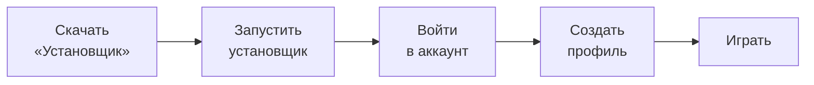

 

**Ставит игру и моды, запускает несколько профилей сразу и показывает твоего персонажа в 3D.**

[**Скачать**](../../releases) &nbsp;•&nbsp; [**Возможности**](#-что-умеет-waundbox) &nbsp;•&nbsp; [**Установка**](#-как-установить) &nbsp;•&nbsp; [**Аккаунты**](#-аккаунты-и-скины) &nbsp;•&nbsp; [**Моды**](#-моды-ресурспаки-и-шейдеры) &nbsp;
 
                              [**сайт**](https://waundbox.github.io/Minecraft-Launcher-Waundbox/) 

 

## ✨ Что умеет Waundbox

| | |
|---|---|
| 🧱 **Любая версия** | Minecraft любой версии, а также Fabric, Quilt, Forge и NeoForge прямо из окна лаунчера, с индикатором прогресса и кнопкой отмены |
| 📦 **Сборки** | Modrinth (`.mrpack`), CurseForge (`.zip`) и твоя собственная версия игры из файла `.jar` |
| 🗂️ **Профили** | У каждого своя версия, папка с мирами и модами, объём памяти, аргументы запуска и значок |
| 🎮 **Несколько игр сразу** | Вывод каждой показывается отдельно во вкладке «Логи» |
| 🔐 **Вход** | Microsoft, Ely.by или локальный режим без входа |
| 🧍 **3D-персонаж** | Твой скин на главной, галерея скинов, смена скина Microsoft прямо из лаунчера |
| 🧩 **Моды** | Моды, ресурспаки и шейдеры из каталога Modrinth вместе с нужными зависимостями |
| 🎨 **Внешний вид** | Тема и цвета на твой вкус, а когда лаунчер не нужен, он экономит ресурсы |

 

## 🚀 Как установить

1. **Скачай лаунчер.** Открой страницу [Releases](../../releases), возьми последний выпуск и скачай из списка файлов «Установщик».
2. **Запусти установщик.** Он сам поставит Waundbox и создаст ярлыки на рабочем столе и в меню «Пуск». Отдельно ставить .NET не нужно.
3. **Открой Waundbox.** Лаунчер работает в одном окне: если он уже запущен, найди его значок на панели задач.
4. **Войди в аккаунт.** Вкладка «Аккаунт»: Microsoft, Ely.by или локальный режим.
5. **Создай профиль.** «Профили» → «Новый профиль»: выбери версию, загрузчик, память и значок.
6. **Нажми «Играть»** на главной.

> [!NOTE]
> Для Forge и NeoForge нужна Java, подходящая для выбранной игры (для Minecraft 1.21 и новее это Java 21). Автоматической загрузки Java пока нет.

 

## 🧱 Игра, загрузчики и сборки

Всё ставится в одном месте: вкладка «Профили» → «Новый профиль» и кнопка «Импорт сборки». Лаунчер скачивает игру, библиотеки и ресурсы, проверяет каждый файл по контрольной сумме, при обрыве сети повторяет попытки и сохраняет уже скачанное.

| Загрузчик | Что важно |
|---|---|
| **Minecraft** | любая версия, есть поиск и переключатель снапшотов |
| **Fabric** и **Quilt** | список берётся с официальных сервисов; установка записывается только после того, как скачаны все файлы, поэтому оборванная установка не оставляет «полуготовой» версии |
| **Forge** | Minecraft 1.13 и новее; лаунчер скачивает официальный установщик, проверяет его контрольную сумму (если она опубликована) и запускает подходящей Java, это может занять несколько минут |
| **NeoForge** | Minecraft 1.20.1 и 1.20.2 и новее; выбирается последняя стабильная сборка, а если стабильных нет, последняя бета |
| **Свой jar** | твой клиент из файла, см. ниже |

<b>📦 Сборки Modrinth и CurseForge</b>

 

**Modrinth (`.mrpack`).** Лаунчер читает описание сборки, ставит нужную версию игры и загрузчик, скачивает все файлы параллельно с проверкой контрольной суммы, распаковывает дополнительные файлы и создаёт профиль. Файлы принимаются только с доверенных адресов (`cdn.modrinth.com`, `github.com`, `raw.githubusercontent.com`, `gitlab.com`) по защищённому соединению, а пути, выходящие за папку профиля, отклоняются.

**CurseForge (`.zip`).** Формат архива определяется автоматически. Нужен бесплатный ключ CurseForge: он уже встроен в лаунчер, а при желании можно вписать свой в «Настройки → CurseForge». Моды, которые авторы запретили скачивать сторонним программам, лаунчер не обходит. Они перечисляются в файле `waundbox-manual-downloads.txt` в папке профиля: скачай их вручную с сайта CurseForge и положи в `mods`.

<b>🛠️ Свой jar</b>

 

В окне «Новый профиль» выбери вариант «Свой jar». Поддерживаются два случая:

1. **Только jar.** Выбираешь файл и версию Minecraft, на которой он основан (если в jar есть `version.json`, версия подставится сама). Библиотеки, ресурсы и Java берутся от базовой версии, а запускается твой jar.
2. **Jar и json версии** (так часто поставляются готовые клиенты). Json с `inheritsFrom` наследуется от базовой версии, а самостоятельный json со своими библиотеками и ресурсами лаунчер скачает сам. Json рядом с jar находится автоматически.

Версия называется `имя+mc1.21.1`. Контрольная сумма твоего jar не проверяется. Клиенты с собственным способом запуска (не через `mainClass` и classpath) не поддерживаются, а моды Modrinth в такие профили не ставятся.

<b>☕ Как лаунчер ищет Java</b>

 

Лаунчер ищет уже установленную Java в `JAVA_HOME`, `PATH`, стандартных папках установки (Eclipse Adoptium, Microsoft, Zulu, BellSoft, Corretto, Semeru) и в средах официального лаунчера, проверяя каждую запуском. Нужная версия берётся из описания игры (для старых версий это Java 8). Если подходящая Java найдена не там, путь можно указать вручную в «Настройках».

 

## 🗂️ Профили и запуск

- **Карточки профилей** показывают значок, версию и состояние. На каждой есть «Играть» / «Остановить», настройки, моды, открытие папки и удаление.
- **Настройки профиля:** память (ползунок до объёма ОЗУ и поле для точного числа), сборщик мусора Java (по умолчанию, G1, ZGC, Shenandoah, Parallel, Serial), аргументы Java и игры, своя Java.
- **Несколько игр сразу.** Один профиль второй раз запустить нельзя: у него общая папка игры. Подготовка к запуску идёт по очереди, а сами игры потом работают независимо.
- **Значки профилей.** Положи картинки (`.png`, `.jpg`, `.bmp`, `.gif`) в папку `icons` рядом с лаунчером (кнопка «Открыть папку значков» в «Настройках»), и они подхватятся сами.
- **Логи.** Вывод игры в реальном времени. Полный журнал каждой игры лежит в `%APPDATA%\.waundbox\logs\game-<профиль>.log`.

> [!WARNING]
> Удаление профиля удаляет и его папку (миры, моды, настройки, скриншоты) без возможности восстановления. Перед этим лаунчер просит подтверждение. Общие файлы версий игры не трогаются.

> [!TIP]
> Данные игрока лежат в `%APPDATA%\.waundbox` (профили, настройки, скины, значки, журналы), а сама игра в `%APPDATA%\.waundbox\minecraft`. При удалении лаунчера эти данные не стираются.

 

## 🔐 Аккаунты и скины

| Способ входа | Как это работает |
|---|---|
| **Microsoft** | Официальный вход: на странице Microsoft вводишь короткий код. Пароль лаунчеру не передаётся и нигде не хранится, а на диске лежат только токены, зашифрованные средствами Windows. Нужна лицензионная Minecraft: Java Edition. Если игра куплена через Game Pass, хотя бы раз войди в официальный лаунчер. |
| **Ely.by** | Вход на сервер авторизации Ely.by, скины и сервера работают через authlib-injector (лаунчер скачивает его сам и проверяет контрольную сумму). Пароль отправляется один раз и не сохраняется. Двухфакторная защита поддерживается. |
| **Локальный режим** | Без входа и проверки лицензии, с ником, который ты задал в «Аккаунте». Подходит для одиночной игры и проверки сборок, но на серверы с проверкой лицензии так не зайти. |

В «Аккаунте» можно выбрать «Автоматически» (Microsoft, затем Ely.by, затем локальный режим) или конкретный способ.

**Скины.** Вкладка «Аккаунт → Скины» — галерея твоих скинов в 2D. У каждого есть «Выбрать» (скин появится на главной), «В Microsoft» (загрузка на сервер Mojang, нужен вход) и «Удалить». Добавить можно PNG 64×64 или 64×32. В локальном режиме выбранный скин применяется и в игре (Minecraft 1.13 и новее), но другие игроки на серверах его не увидят.

 

## 🧩 Моды, ресурспаки и шейдеры

Кнопка «Моды» на карточке профиля открывает каталог [Modrinth](https://modrinth.com): поиск, три типа (моды, ресурспаки, шейдеры), сортировка и подбор по версии игры и загрузчику профиля.

- Ставится лучшая подходящая версия (свежий релиз, а бета или альфа только если релизов нет) вместе с обязательными зависимостями.
- Контрольная сумма проверяется, а скачивание идёт только с серверов Modrinth по защищённому соединению.
- Лаунчер ведёт список только того, что поставил сам (файл `.waundbox-content.json` в папке профиля). Такие файлы можно обновить или удалить из окна, а файлы, положенные вручную, он не трогает.
- Для шейдеров обычно нужен мод Iris (Fabric) или OptiFine.

 

## 🧍 3D-персонаж

Справа на главной стоит 3D-модель игрока со скином (Steve или Alex). Её можно повернуть мышью, а сама она медленно вращается (это выключается в «Настройках»).

- **Откуда скин.** С серверов Mojang, если ты вошёл через Microsoft, иначе выбранный в «Аккаунте → Скины». Если скина нет, показывается стандартная раскраска.
- **Настройки модели.** Поза (стоит, идёт, машет рукой, руки в стороны, бодрая), второй слой скина (шапка, куртка, рукава, штаны) и возможность скрыть модель целиком.
- **Своя модель из Blockbench.** «Настройки → Модель персонажа → Выбрать модель Blockbench…» (файл `.bbmodel`). Кнопка «Сохранить шаблон для Blockbench…» записывает стандартную модель с твоим скином в файл, чтобы ты мог изменить её и подключить обратно.
- **Как рисуется.** Лаунчер рисует модель сам: каждый непрозрачный пиксель скина — маленький квадратик в пространстве с учётом глубины. Поэтому нет «съехавших» пикселей, светлых линий на стыках второго слоя и размытия текстуры. Пока модель вращается, она рисуется в небольшом кадре и почти не нагружает процессор, а когда стоит, перерисовывается в полный размер окна.

 

## 🖥️ Интерфейс

- **Вкладки:** «Главная», «Профили», «Логи», «Аккаунт», «Настройки». Переключаться можно кликом или `Ctrl` + `←` / `→`.
- **Тема и цвета:** светлая или тёмная тема, основной цвет и цвет фона — готовые образцы, круглая палитра или свой код `#RRGGBB`. Применяется сразу.
- **Свечение на фоне** — мягкий «дым» позади окна, который можно выключить совсем.
- **Экономия ресурсов.** Экономный режим отключает анимации и дым. Он включается сам, если 10 секунд ничего не нажимали, а фон замирает, пока игра запущена или окно свёрнуто. Свёрнутый лаунчер выгружает модель и сжимает память.

 

## 📌 Что важно знать

- Лаунчер работает только в **Windows**.
- Forge старше Minecraft 1.13 и NeoForge старше 1.20.1 не поддерживаются.
- Установщик Forge и NeoForge — внешняя программа: он сам скачивает свои библиотеки, а лаунчер ждёт его не дольше 20 минут.
- Для Fabric Loader без контрольной суммы в описании (сам загрузчик и intermediary) файл скачивается заново при каждой установке, потому что проверять его нечем.
- Свободное место проверяется для каждого файла отдельно, а не для всей установки сразу.
- Скин Ely.by меняется только на сайте ely.by.

 

## 🗺️ Планы

- [ ] Рекомендации модов, которые обновляются удалённо, и установка сборок прямо из каталога Modrinth
- [ ] Сайт со скинами: аккаунты, загрузка скинов и показ скинов пользователей лаунчера в игре (лаунчер при этом не будет зависеть от сервера)
- [ ] Автоматическая загрузка Java из проверенного источника
- [ ] Более полная настройка внешнего вида главной страницы
- [ ] Переработка лаунчера на Linux

 

## 📝 Что нового в 1.0.0

Первая выпускная версия. Она собирает в себе все изменения ветки 0.99:

- установка собственной версии игры из `.jar` (вариант «Свой jar»);
- новые размеры главной и верхней панели для большого экрана, модель по центру между панелью и краем окна;
- чёткая 3D-модель на любом размере окна при малой нагрузке на процессор и память;
- скин Microsoft и скин Ely.by теперь загружаются, а в «Аккаунте» у каждого способа входа показана голова скина;
- удаление профиля удаляет и его папку;
- экономия при бездействии, переключатель свечения на фоне, сжатие памяти у свёрнутого лаунчера;
- исправлена кнопка «Сохранить шаблон для Blockbench…»;
- локальный режим (без входа) теперь так и называется.

 

Сделано с любовью к Minecraft ⛏️

Waundbox не связан с Mojang и Microsoft.

