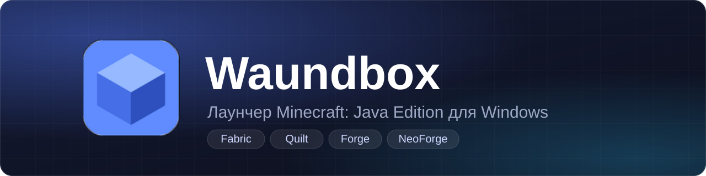

<div align="center">



<br>


**Ставит игру и моды, запускает несколько профилей сразу и показывает твоего персонажа в 3D.**

[**Скачать**](../../releases) &nbsp;•&nbsp; [**Возможности**](#-что-умеет-waundbox) &nbsp;•&nbsp; [**Установка**](#-как-установить) &nbsp;•&nbsp; [**Аккаунты**](#-аккаунты-и-скины) &nbsp;•&nbsp; [**Моды**](#-моды-ресурспаки-и-шейдеры) &nbsp;
<br>
                              [**сайт**](https://waundbox.github.io/Minecraft-Launcher-Waundbox/)
</div>

<br>

## ✨ Что умеет Waundbox

| | |
|---|---|
| 🧱 **Любая версия** | Minecraft любой версии, а также Fabric, Quilt, Forge и NeoForge прямо из окна лаунчера, с индикатором прогресса и кнопкой отмены |
| 📦 **Сборки** | Modrinth (`.mrpack`), CurseForge (`.zip`) и твоя собственная версия игры из файла `.jar` |
| 🗂️ **Профили** | У каждого своя версия, папка с мирами и модами, объём памяти, аргументы запуска и значок |
| 🎮 **Несколько игр сразу** | Вывод каждой показывается отдельно во вкладке «Логи» |
| 🔐 **Вход** | Microsoft, Ely.by или локальный режим без входа |
| 🧍 **3D-персонаж** | Твой скин на главной, галерея скинов, смена скина Microsoft прямо из лаунчера |
| 🧩 **Моды** | Моды, ресурспаки и шейдеры из каталога Modrinth вместе с нужными зависимостями |
| 🎨 **Внешний вид** | Готовые и свои темы, меню сверху или слева, «жидкое стекло», а когда лаунчер не нужен, он экономит ресурсы |
| ✏️ **Свой интерфейс** | Редактор: двигай, растягивай и скрывай любые плитки на любой странице, раскладка запоминается под каждой темой |

<br>

## 🚀 Как установить

```mermaid

flowchart LR

&#x20;   A\[Скачать<br>«Установщик»] --> B\[Запустить<br>установщик] --> C\[Войти<br>в аккаунт] --> D\[Создать<br>профиль] --> E\[Играть]

```

1. **Скачай лаунчер.** Открой страницу [Releases](../../releases), возьми последний выпуск и скачай из списка файлов «Установщик».
2. **Запусти установщик.** Он сам поставит Waundbox и создаст ярлыки на рабочем столе и в меню «Пуск». Отдельно ставить .NET не нужно.
3. **Открой Waundbox.** Лаунчер работает в одном окне: если он уже запущен, найди его значок на панели задач. Дальше он сам сообщит о новой версии: кнопка «Обновление» в верхней панели.
4. **Войди в аккаунт.** Вкладка «Аккаунт»: Microsoft, Ely.by или локальный режим.
5. **Создай профиль.** «Профили» → «Новый профиль»: выбери версию, загрузчик, память и значок.
6. **Нажми «Играть»** на главной.

> \[!NOTE]
> Для Forge и NeoForge нужна Java, подходящая для выбранной игры (для Minecraft 1.21 и новее это Java 21). Автоматической загрузки Java пока нет.

<br>

## 🧱 Игра, загрузчики и сборки

Всё ставится в одном месте: вкладка «Профили» → «Новый профиль» и кнопка «Импорт сборки». Лаунчер скачивает игру, библиотеки и ресурсы, проверяет каждый файл по контрольной сумме, при обрыве сети повторяет попытки и сохраняет уже скачанное.

| Загрузчик | Что важно |
|---|---|
| **Minecraft** | любая версия, есть поиск и переключатель снапшотов |
| **Fabric** и **Quilt** | список берётся с официальных сервисов; установка записывается только после того, как скачаны все файлы, поэтому оборванная установка не оставляет «полуготовой» версии |
| **Forge** | Minecraft 1.13 и новее; лаунчер скачивает официальный установщик, проверяет его контрольную сумму (если она опубликована) и запускает подходящей Java, это может занять несколько минут |
| **NeoForge** | Minecraft 1.20.1 и 1.20.2 и новее; выбирается последняя стабильная сборка, а если стабильных нет, последняя бета |
| **Свой jar** | твой клиент из файла, см. ниже |

<details>
<summary><b>📦 Сборки Modrinth и CurseForge</b></summary>

<br>

**Modrinth (`.mrpack`).** Лаунчер читает описание сборки, ставит нужную версию игры и загрузчик, скачивает все файлы параллельно с проверкой контрольной суммы, распаковывает дополнительные файлы и создаёт профиль. Файлы принимаются только с доверенных адресов (`cdn.modrinth.com`, `github.com`, `raw.githubusercontent.com`, `gitlab.com`) по защищённому соединению, а пути, выходящие за папку профиля, отклоняются.

**CurseForge (`.zip`).** Формат архива определяется автоматически. Нужен бесплатный ключ CurseForge: он уже встроен в лаунчер, а при желании можно вписать свой в «Настройки → CurseForge». Моды, которые авторы запретили скачивать сторонним программам, лаунчер не обходит. Они перечисляются в файле `waundbox-manual-downloads.txt` в папке профиля: скачай их вручную с сайта CurseForge и положи в `mods`.

</details>

<details>
<summary><b>🛠️ Свой jar</b></summary>

<br>

В окне «Новый профиль» выбери вариант «Свой jar». Поддерживаются два случая:

1. **Только jar.** Выбираешь файл и версию Minecraft, на которой он основан (если в jar есть `version.json`, версия подставится сама). Библиотеки, ресурсы и Java берутся от базовой версии, а запускается твой jar.
2. **Jar и json версии** (так часто поставляются готовые клиенты). Json с `inheritsFrom` наследуется от базовой версии, а самостоятельный json со своими библиотеками и ресурсами лаунчер скачает сам. Json рядом с jar находится автоматически.

Версия называется `имя+mc1.21.1`. Контрольная сумма твоего jar не проверяется. Клиенты с собственным способом запуска (не через `mainClass` и classpath) не поддерживаются, а моды Modrinth в такие профили не ставятся.

</details>

<details>
<summary><b>☕ Как лаунчер ищет Java</b></summary>

<br>

Лаунчер ищет уже установленную Java в `JAVA\_HOME`, `PATH`, стандартных папках установки (Eclipse Adoptium, Microsoft, Zulu, BellSoft, Corretto, Semeru) и в средах официального лаунчера, проверяя каждую запуском. Нужная версия берётся из описания игры (для старых версий это Java 8). Если подходящая Java найдена не там, путь можно указать вручную в «Настройках».

</details>

<br>

## 🗂️ Профили и запуск

- **Карточки профилей** показывают значок, версию и состояние. На каждой есть «Играть» / «Остановить», настройки, моды, открытие папки и удаление.
- **Настройки профиля:** память (ползунок до объёма ОЗУ и поле для точного числа), сборщик мусора Java (по умолчанию, G1, ZGC, Shenandoah, Parallel, Serial), аргументы Java и игры, своя Java.
- **Несколько игр сразу.** Один профиль второй раз запустить нельзя: у него общая папка игры. Подготовка к запуску идёт по очереди, а сами игры потом работают независимо.
- **Значки профилей.** Положи картинки (`.png`, `.jpg`, `.bmp`, `.gif`) в папку `icons` рядом с лаунчером (кнопка «Открыть папку значков» в «Настройках»), и они подхватятся сами.
- **Логи.** Вывод игры в реальном времени. Полный журнал каждой игры лежит в `%APPDATA%\\.waundbox\\logs\\game-<профиль>.log`.

> \[!WARNING]
> Удаление профиля удаляет и его папку (миры, моды, настройки, скриншоты) без возможности восстановления. Перед этим лаунчер просит подтверждение. Общие файлы версий игры не трогаются.

> \[!TIP]
> Данные игрока лежат в `APPDATA\\.waundbox` (профили, настройки, скины, значки, журналы), а сама игра в `%APPDATA%\\.waundbox\\minecraft`. При удалении лаунчера эти данные не стираются.

<br>

## 🔐 Аккаунты и скины

| Способ входа | Как это работает |
|---|---|
| **Microsoft** | Официальный вход: на странице Microsoft вводишь короткий код. Пароль лаунчеру не передаётся и нигде не хранится, а на диске лежат только токены, зашифрованные средствами Windows. Нужна лицензионная Minecraft: Java Edition. Если игра куплена через Game Pass, хотя бы раз войди в официальный лаунчер. |
| **Ely.by** | Вход на сервер авторизации Ely.by, скины и сервера работают через authlib-injector (лаунчер скачивает его сам и проверяет контрольную сумму). Пароль отправляется один раз и не сохраняется. Двухфакторная защита поддерживается. |
| **Локальный режим** | Без входа и проверки лицензии, с ником, который ты задал в «Аккаунте». Подходит для одиночной игры и проверки сборок, но на серверы с проверкой лицензии так не зайти. |

В «Аккаунте» можно выбрать «Автоматически» (Microsoft, затем Ely.by, затем локальный режим) или конкретный способ.

**Скины.** Вкладка «Аккаунт → Скины» — галерея твоих скинов в 2D. У каждого есть «Выбрать» (скин появится на главной), «В Microsoft» (загрузка на сервер Mojang, нужен вход) и «Удалить». Добавить можно PNG 64×64 или 64×32. В локальном режиме выбранный скин применяется и в игре (Minecraft 1.13 и новее), но другие игроки на серверах его не увидят.

<br>

## 🧩 Моды, ресурспаки и шейдеры

Кнопка «Моды» на карточке профиля открывает каталог [Modrinth](https://modrinth.com): поиск, три типа (моды, ресурспаки, шейдеры), сортировка и подбор по версии игры и загрузчику профиля.

- Ставится лучшая подходящая версия (свежий релиз, а бета или альфа только если релизов нет) вместе с обязательными зависимостями.
- Контрольная сумма проверяется, а скачивание идёт только с серверов Modrinth по защищённому соединению.
- Лаунчер ведёт список только того, что поставил сам (файл `.waundbox-content.json` в папке профиля). Такие файлы можно обновить или удалить из окна, а файлы, положенные вручную, он не трогает.
- Для шейдеров обычно нужен мод Iris (Fabric) или OptiFine.

<br>

## 🧍 3D-персонаж

Справа на главной стоит 3D-модель игрока со скином (Steve или Alex). Её можно повернуть мышью, а сама она медленно вращается (это выключается в «Настройках»).

- **Откуда скин.** С серверов Mojang, если ты вошёл через Microsoft, иначе выбранный в «Аккаунте → Скины». Если скина нет, показывается стандартная раскраска.
- **Настройки модели.** Поза (стоит, идёт, машет рукой, руки в стороны, бодрая), второй слой скина (шапка, куртка, рукава, штаны) и возможность скрыть модель целиком.
- **Своя модель из Blockbench.** «Настройки → Модель персонажа → Выбрать модель Blockbench…» (файл `.bbmodel`). Кнопка «Сохранить шаблон для Blockbench…» записывает стандартную модель с твоим скином в файл, чтобы ты мог изменить её и подключить обратно.
- **Как рисуется.** Лаунчер рисует модель сам: каждый непрозрачный пиксель скина — маленький квадратик в пространстве с учётом глубины. Поэтому нет «съехавших» пикселей, светлых линий на стыках второго слоя и размытия текстуры. Пока модель вращается, она рисуется в небольшом кадре и почти не нагружает процессор, а когда стоит, перерисовывается в полный размер окна.

<br>

## 🖥️ Интерфейс

- **Вкладки:** «Главная», «Профили», «Логи», «Аккаунт», «Настройки». Переключаться можно кликом или `Ctrl` + `←` / `→`. Меню можно разместить сверху или слева: слева оно узкое и выезжает с названиями, когда подводишь мышь («Настройки → Оформление»).
- **Темы.** «Настройки → Оформление → Готовые темы»: тему можно сначала примерить, потом «Применить» или «Отмена». Свои темы сохраняются в папку `themes` и показываются в «Мои темы». Картинки предпросмотра лежат в папке `preview`.
- **Цвета.** Светлая или тёмная тема, основной цвет, цвет фона и фона виджетов, цвет текста: готовые образцы, круглая палитра или свой код `#RRGGBB`. Применяется сразу.
- **Свечение и жидкое стекло.** Свечение — мягкий «дым» позади окна, его можно выключить совсем. Жидкое стекло делает панели прозрачными, с бликом и яркой кромкой; нагрузки на процессор оно не даёт.
- **Редактор интерфейса.** Открывается из «Настройки → Оформление». Любую плитку на любой странице можно двигать, растягивать (в том числе по одной стороне), скрывать, делать прозрачнее и скруглять. Страницы и вкладки переключаются кнопками в окне редактора, а «Сохранить тему» открывает отдельное окно. Раскладка запоминается под каждой темой.
- **Экономия ресурсов.** Экономный режим отключает анимации и дым. Он включается сам, если 10 секунд ничего не нажимали, а фон замирает, пока игра запущена или окно свёрнуто. Свёрнутый лаунчер выгружает модель и сжимает память.

<br>

## 📌 Что важно знать

- Лаунчер работает только в **Windows**.
- Установщик Forge и NeoForge — внешняя программа: он сам скачивает свои библиотеки, а лаунчер ждёт его не дольше 20 минут.
- Для Fabric Loader без контрольной суммы в описании (сам загрузчик и intermediary) файл скачивается заново при каждой установке, потому что проверять его нечем.
- Свободное место проверяется для каждого файла отдельно, а не для всей установки сразу.
- Скин Ely.by меняется только на сайте ely.by.

<br>

## 🗺️ Планы

- [ ] Рекомендации модов, которые обновляются удалённо, и установка сборок прямо из каталога Modrinth | Официально анонсирована в обновлении v3.0.0
- [ ] Сайт со скинами: аккаунты, загрузка скинов и показ скинов пользователей лаунчера в игре (лаунчер при этом не будет зависеть от сервера) | пока не известно.
- [ ] Автоматическая загрузка Java из проверенного источника | Официально анонсирована в обновлении v3.0.0
- [x] Режим полной настройки интерфейса | Готово в обновлении v2.0.0
- [ ] Переработка лаунчера на Linux | Официально анонсирована в обновлении v3.0.0

<br>

## 📝 Что нового в 1.0.0

Первая выпускная версия. Она собирает в себе все изменения ветки 0.99:

- установка собственной версии игры из `.jar` (вариант «Свой jar»);
- новые размеры главной и верхней панели для большого экрана, модель по центру между панелью и краем окна;
- чёткая 3D-модель на любом размере окна при малой нагрузке на процессор и память;
- скин Microsoft и скин Ely.by теперь загружаются, а в «Аккаунте» у каждого способа входа показана голова скина;
- удаление профиля удаляет и его папку;
- экономия при бездействии, переключатель свечения на фоне, сжатие памяти у свёрнутого лаунчера;
- исправлена кнопка «Сохранить шаблон для Blockbench…»;
- локальный режим (без входа) теперь так и называется.

<br>

## 📝 Что нового в 1.1.0

<details>
<summary><b>Автообновление</b></summary>
 
- **Лаунчер сам узнаёт о новой версии** и предлагает обновиться. Проверка идёт при запуске и затем раз в 4 часа. Её можно отключить в «Настройках» переключателем «Проверять обновления» или запустить вручную кнопкой «Проверить обновления».
- **Обычное обновление.** Появляется окно, а правее вкладки «Аккаунт» — вкладка «Обновление». Кнопки:
  - «Установить» — лаунчер сам скачивает установщик и запускает его;
  - «Установить самому» — открывается страница релиза;
  - «Позже» — напомним при следующем запуске.
- **Обязательное обновление.** Если выпуск помечен как обязательный, окно показывается без «Позже» и без крестика, а страницы лаунчера под ним недоступны. Окно остаётся и после перезапуска, пока не будет установлена нужная версия. Блокировка работает и без интернета: нужная версия запоминается в настройках. Ошибка сети блокировку не снимает.
- **Установка внутри лаунчера.** Установщик скачивается во временную папку, проверяется по SHA-256 и только после этого запускается в тихом режиме. Лаунчер закрывается, установщик ставит новую версию поверх старой и сам её запускает. Данные игрока в `%APPDATA%\\.waundbox` не затрагиваются. Если запущена игра, лаунчер сначала предупредит, что закроется.

### Откуда берутся сведения

Из списка релизов этого репозитория через GitHub API. Номер версии берётся из тега (например, `v2.0.0`), а если тег не похож на номер, то из названия релиза. Черновики и предварительные выпуски пропускаются. Самый новый выпуск определяется по номеру версии, а не по дате.

### Безопасность

- Скачивать можно только файлы выпусков этого репозитория и только по `https`.
- Размер файла ограничен.
- Контрольная сумма берётся по порядку из трёх источников: поле `digest` у файла релиза, строка `SHA-256: …` в описании релиза, файл `имя.exe.sha256` среди файлов релиза.
- Если суммы нет, установить из лаунчера нельзя, остаётся кнопка «Установить самому».
- Неполный или не совпавший по сумме файл удаляется и не запускается.

> \*\*Честное ограничение.\*\* Если взломают учётную запись GitHub, подменят и файл, и его сумму. От этого защитит только подпись установщика. Она платная и пока не подключена.
</details>

<details>
  <summary>Жидкое стекло</summary>
Новый переключатель в «Настройки → Оформление». Применяется сразу, без перезапуска, по умолчанию выключен.

Панели и диалоги получают диагональные градиенты: блик в левом верхнем углу и переливающуюся светлую кромку. Для светлой и тёмной темы значения свои. Размытия фона и эффектов нет, поэтому нагрузка на процессор и память не растёт. В 2.0.0 жидкое стекло переработано, см. ниже.
</details>

### Важно

Проверка обновлений есть только в версиях, где она появилась. Если у вас стоит 1.0.0, уведомления не будет: один раз поставьте 1.1.0 вручную, дальше лаунчер всё сделает сам.
<br>

## 📝 Что нового в 2.0.0

Большое обновление интерфейса: редактор работает на всех страницах, появились готовые и свои темы, меню слева и настоящее «жидкое стекло».

<details>
<summary><b>✏️ Редактор интерфейса</b></summary>

<br>

- **Правка везде.** Любую плитку на любой странице можно двигать, растягивать, скрывать, делать прозрачнее, скруглять и менять порядок слоёв. Помогает сетка.
- **Растягивание по сторонам.** У выбранной плитки на серединах сторон есть ручки: каждая тянет только свою сторону. Для точной настройки есть ползунки «Ширина» и «Высота».
- **Отдельное окно.** Панель редактора открывается отдельным окном. Страницы и вкладки (Общее, Оформление, Готовые темы, Аккаунт, Скины) переключаются кнопками прямо в нём.
- **Мелкие детали.** Внутри плиток «Оформления» кнопки, заголовки, образцы цветов и круги тоже правятся по отдельности.
- **Вкладки сверху.** Порядок вкладок и их показ настраиваются в редакторе.
- **Профили.** Карточки профилей на главной и на странице «Профили» можно перетаскивать на новое место.
- **Открыть редактор** можно из «Настройки → Оформление».

</details>

<details>
<summary><b>🎨 Темы</b></summary>

<br>

- **Готовые темы.** Тему можно сначала примерить, потом нажать «Применить» или «Отмена». Пока тема не применена, она не сохраняется.
- **Предпросмотр** показывает окно лаунчера на фоне самой темы, в светлом или тёмном варианте, как включено у тебя. Картинки лежат в папке `preview`, их можно заменить своими.
- **Свои темы.** Кнопка «Сделать свою тему» открывает редактор. «Сохранить тему» открывает отдельное окно: название (до 16 символов, обязательно), описание и цвет текста (необязательно). Тема сохраняется в папку `themes` со всеми настройками и появляется в «Мои темы».
- **Раскладка по темам.** Всё, что ты поправил в интерфейсе, запоминается под выбранной темой и возвращается, когда ты её включаешь снова.
- **Цвет текста.** Можно задать свой, а если не задан, он подбирается по яркости фона.

</details>

<details>
<summary><b>🖥️ Внешний вид</b></summary>

<br>

- **Меню слева.** В «Настройки → Оформление» меню можно разместить сверху или слева. Слева оно узкое и выезжает с названиями вкладок, когда подводишь мышь. Цвет у него такой же, как у верхней панели.
- **«Оформление» перерисовано.** Сверху тема, расположение, свечение и жидкое стекло, ниже три цветовых блока: основной цвет, фон виджетов и фон.
- **Панели стали прозрачнее.**
- **Жидкое стекло теперь стекло.** Молочная прозрачная заливка, блик в углу, отсвет с противоположной стороны и тонкая яркая кромка. Размытия фона нет, поэтому нагрузка не растёт.
- **Фон виджетов** настраивается отдельно: образцы, круг цвета, поле `#RRGGBB` и кнопка «По умолчанию».
- **Надпись Waundbox** есть в светлом и тёмном вариантах, у обычной темы лёгкий туман.
- **Значок у вкладки «Логи».**
- **Тень под персонажем** на главной.
- **Голова скина** в «Аккаунте» и «Скинах» рисуется с обоими слоями и слегка скруглена.
- **Плавные переходы** между страницами и вкладками настроек.

</details>

<details>
<summary><b>🔄 Обновления</b></summary>

<br>

- **Кнопка «Обновление»** в верхней панели справа вместо отдельной вкладки.
- **Запасной источник.** Если сайт обновлений недоступен или исчерпан лимит запросов, лаунчер берёт сведения из запасной ленты. Частые ручные проверки берут прежний ответ, а не обращаются к сети заново.

</details>

<div align="center">

Сделано с любовью к Minecraft ⛏️

<sub>Waundbox не связан с Mojang и Microsoft.</sub>

</div>
